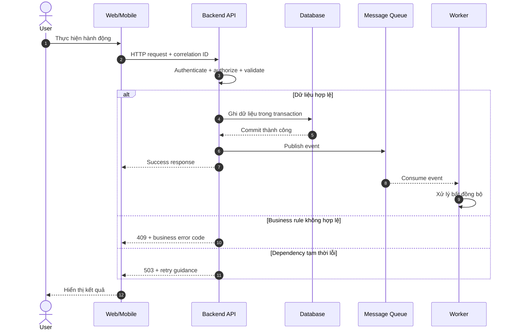
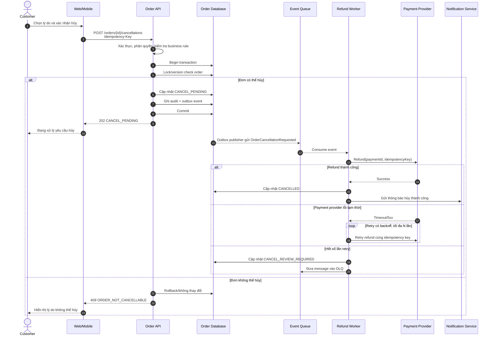
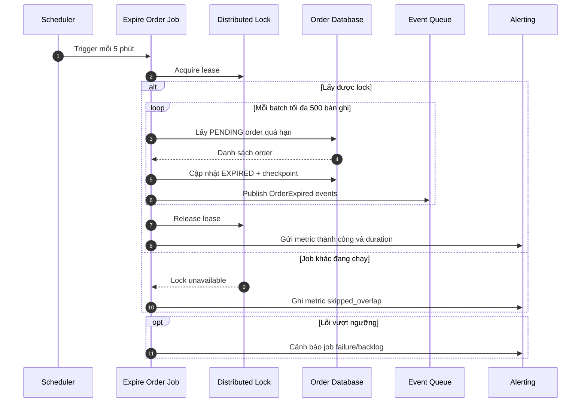

# Quy trình phát triển phần mềm cho dự án gấp và có nhiều bug

## 1. Mục tiêu và mô hình vận hành

Đề xuất áp dụng mô hình **Scrumban phục hồi dự án**: sử dụng luồng Kanban để xử lý bug và sự cố liên tục, đồng thời duy trì nhịp lập kế hoạch, demo và retrospective hằng tuần.

Trong tình trạng hiện tại, Scrum thuần với Sprint dài dễ bị phá vỡ bởi bug khẩn cấp. Quy trình này hướng tới ba mục tiêu:

1. Trong 48–72 giờ: kiểm soát được backlog, source code và cách release.
2. Trong hai tuần: giảm bug nghiêm trọng, không còn release không có kiểm soát.
3. Trong 4–6 tuần: thiết lập quy trình phát triển ổn định cho Web, Mobile và Java Backend.

---

## 2. Cơ cấu trách nhiệm

Một người có thể kiêm nhiều vai trò nếu đội nhỏ, nhưng không được bỏ trống trách nhiệm.

| Vai trò | Trách nhiệm chính | Quyền quyết định |
|---|---|---|
| Product Owner – PO | Quản lý backlog, làm rõ nghiệp vụ, ưu tiên công việc | Làm cái gì trước, cắt phạm vi nào |
| Delivery Lead/PM | Theo dõi tiến độ, dependency, rủi ro, điều phối team | Điều phối kế hoạch và nhân lực |
| Tech Lead | Kiến trúc, API, chất lượng code, giải quyết vấn đề kỹ thuật | Cách triển khai, có cho phép merge/release hay không |
| Backend Lead | Java Backend, database, API, performance | Giải pháp Backend |
| Web Lead | Web Frontend, browser compatibility | Giải pháp Web |
| Mobile Lead | Android/iOS, tương thích phiên bản Backend | Giải pháp Mobile |
| QA Lead | Test strategy, regression, release validation | Chất lượng đã đủ bằng chứng để release chưa |
| DevOps/Release Owner | CI/CD, môi trường, monitoring, deployment, rollback | Thực hiện hoặc dừng deployment |
| Incident Commander | Điều phối khi có sự cố production | Ưu tiên khắc phục sự cố |

### Nguyên tắc bắt buộc

- PO là người duy nhất quyết định thứ tự ưu tiên.
- Tech Lead có quyền chặn release nếu có rủi ro kỹ thuật nghiêm trọng.
- QA không phải người duy nhất chịu trách nhiệm chất lượng; developer phải tự kiểm thử phần mình làm.
- Mỗi feature có một người chịu trách nhiệm end-to-end, kể cả khi có subtask Backend, Web và Mobile.
- Không nhận việc qua chat rồi làm luôn. Mọi công việc phải có ticket.

Tham khảo: [Scrum Guide chính thức](https://scrumguides.org/scrum-guide.html).

---

## 3. Kế hoạch cứu dự án trong 72 giờ đầu

### 3.1. Ngày 1: Thiết lập quyền kiểm soát

#### Tạm dừng thay đổi không cần thiết

Trong 24–48 giờ:

- Chỉ xử lý sự cố P0/P1.
- Không merge feature mới chưa được đánh giá.
- Không release nếu chưa có người chịu trách nhiệm và kế hoạch rollback.
- Nếu production đang hỏng, ưu tiên rollback hoặc tắt feature trước, sau đó mới điều tra nguyên nhân.

Mục đích không phải dừng dự án lâu dài, mà để thiết lập lại một trạng thái ổn định.

#### Chọn một hệ thống quản lý công việc duy nhất

Có thể dùng Jira, Azure DevOps, GitHub Projects hoặc công cụ hiện tại, nhưng chỉ có **một backlog chính**.

Không duy trì các danh sách riêng biệt như:

- Bug trong Excel.
- Feature trong Jira.
- Việc gấp trong nhóm chat.
- Việc cá nhân trong ghi chú.

Tất cả phải được đưa vào một nơi.

#### Lập danh sách hệ thống

Tech Lead tạo một trang tổng quan gồm:

- Repository Backend.
- Repository Web.
- Repository Mobile Android/iOS.
- Các service, database, queue, cache và dịch vụ bên thứ ba.
- URL DEV, Staging, Production.
- Cách build từng ứng dụng.
- Cách deploy và rollback.
- Người có quyền truy cập.
- Phiên bản hiện đang chạy trên từng môi trường.
- Mobile version nào đang được người dùng sử dụng.
- Các API được mỗi Mobile version gọi.

Đây là bản đồ hệ thống tối thiểu để tránh sửa một nơi nhưng làm hỏng nơi khác.

### 3.2. Ngày 2: Kiểm kê và phân loại bug

Tập hợp toàn bộ bug, sau đó:

1. Loại ticket trùng.
2. Đóng ticket không thể tái hiện sau khi đã xác minh.
3. Gắn mức độ nghiêm trọng.
4. Gắn component: Backend, Web, Android, iOS, Database, Infrastructure.
5. Xác định version và môi trường xảy ra.
6. Chỉ định owner.
7. Tìm các nhóm bug có chung nguyên nhân.

Không sửa bug chỉ theo số lượng. Nếu nhiều bug đến từ cùng một module hoặc cùng một kiểu lỗi API, cần ưu tiên xử lý nguyên nhân hệ thống.

### 3.3. Ngày 3: Thiết lập đường sống kỹ thuật

Tối thiểu phải có:

- Nhánh `main` được bảo vệ.
- Không push trực tiếp vào `main`.
- Merge qua Pull Request.
- Build tự động.
- Unit test chạy tự động.
- Có môi trường Staging.
- Có smoke test cho 3–5 luồng quan trọng nhất.
- Có log và cảnh báo production.
- Có hướng dẫn rollback.
- Có người chịu trách nhiệm cho từng lần release.

Tham khảo: [GitHub Branch Protection](https://docs.github.com/en/repositories/configuring-branches-and-merges/managing-protected-branches/about-protected-branches).

---

## 4. Phân loại mức độ bug và sự cố

Thời gian dưới đây là mục tiêu nội bộ khởi đầu; cần điều chỉnh theo quy mô và SLA của sản phẩm.

| Mức | Định nghĩa | Ví dụ | Phản hồi |
|---|---|---|---|
| P0 – Critical | Hệ thống ngừng hoạt động, mất dữ liệu, rò rỉ dữ liệu, lỗi thanh toán diện rộng | Không đăng nhập được toàn hệ thống | Xác nhận trong 10 phút, xử lý liên tục đến khi giảm ảnh hưởng |
| P1 – High | Chức năng quan trọng hỏng, nhiều người bị ảnh hưởng, không có workaround hợp lý | Không tạo được đơn hàng | Xác nhận trong 30 phút, có phương án trong hai giờ |
| P2 – Medium | Chức năng có lỗi nhưng có workaround, ảnh hưởng giới hạn | Một bộ lọc hoạt động sai | Triage trong một ngày làm việc |
| P3 – Low | UI nhỏ, cải tiến, edge case ít ảnh hưởng | Sai khoảng cách, lỗi text | Đưa vào kế hoạch hằng tuần |

### Quy tắc xử lý

- Chỉ P0/P1 được phép chen ngang kế hoạch.
- Luồng khẩn cấp có WIP limit bằng 1: cả đội không được cùng lúc gọi mọi bug là khẩn cấp.
- P0 ưu tiên giảm ảnh hưởng trước: rollback, tắt feature, chuyển traffic hoặc khôi phục dữ liệu.
- Sau khi ổn định mới phân tích nguyên nhân gốc.

Tham khảo: [Google SRE Incident Management Guide](https://sre.google/resources/practices-and-processes/incident-management-guide/).

---

## 5. Workflow thống nhất cho mọi ticket

Sử dụng luồng trạng thái:

```text
Inbox
  → Triage
  → Ready
  → In Development
  → Code Review
  → Integrated QA
  → Ready for Release
  → Released / Production Verification
  → Done
```

`Blocked` nên là cờ hoặc nhãn, không phải nơi ticket nằm vô thời hạn.

### 5.1. Inbox

Ticket mới tạo, chưa được xác minh.

Điều kiện chuyển sang Triage:

- Có mô tả tối thiểu.
- Có người báo cáo hoặc nguồn yêu cầu.

### 5.2. Triage

PO, QA và Tech Lead xác định:

- Có phải bug thật không.
- Mức độ P0–P3.
- Component bị ảnh hưởng.
- Có trùng ticket không.
- Ai chịu trách nhiệm làm rõ.
- Xử lý ngay, lên kế hoạch hay đóng.

### 5.3. Ready

Ticket đã đạt Definition of Ready. Developer có thể bắt đầu mà không phải đoán yêu cầu.

### 5.4. In Development

Developer đang thực sự làm. Mỗi developer chỉ nên có tối đa một ticket chính ở trạng thái này.

### 5.5. Code Review

Đã tạo PR, CI đã chạy và tác giả đã tự kiểm tra. Nếu review yêu cầu sửa, ticket trở lại In Development.

### 5.6. Integrated QA

Code đã được tích hợp trên môi trường kiểm thử. QA kiểm tra trên luồng hoàn chỉnh, không chỉ từng repository riêng lẻ.

### 5.7. Ready for Release

Đã đạt Definition of Done về kỹ thuật, có kế hoạch release và rollback.

### 5.8. Released / Production Verification

Đã deploy nhưng đang thực hiện:

- Smoke test production.
- Kiểm tra log và error rate.
- Kiểm tra business metric.
- Kiểm tra crash rate với Mobile.

### 5.9. Done

Đã phát hành, xác minh thành công và không có lỗi nghiêm trọng liên quan.

---

## 6. Definition of Ready – điều kiện để bắt đầu làm

Một feature hoặc bug chỉ được đưa vào `Ready` khi có:

- Mục tiêu nghiệp vụ.
- Phạm vi rõ ràng.
- Acceptance Criteria có thể kiểm thử.
- Platform bị ảnh hưởng: Backend, Web, Android, iOS.
- Thiết kế UI/UX nếu cần.
- API contract nếu có giao tiếp Backend–Frontend.
- Dependency và thứ tự triển khai.
- Dữ liệu hoặc quyền truy cập cần thiết.
- Rủi ro và trường hợp đặc biệt.
- Cách bật/tắt hoặc rollback.
- Estimate sơ bộ.
- Người chịu trách nhiệm chính.

Acceptance Criteria nên viết theo dạng:

```text
Given: Người dùng đã đăng nhập và có đơn hàng hợp lệ
When: Người dùng nhấn “Hủy đơn”
Then:
- Đơn chuyển sang trạng thái CANCELLED
- Web và Mobile hiển thị trạng thái mới
- Không thể tiếp tục thanh toán
- Hệ thống ghi lại người thực hiện và thời gian
```

Ticket lớn hơn khoảng 2–3 ngày phát triển nên được chia nhỏ. Trong dự án gấp, ticket nhỏ giúp review, test và rollback dễ hơn.

---

## 7. Quy trình phát triển một feature Web–Mobile–Backend

### Bước 1: Làm rõ nghiệp vụ

PO, QA và đại diện kỹ thuật thống nhất:

- Luồng chính.
- Luồng lỗi.
- Quyền truy cập.
- Trạng thái dữ liệu.
- Hành vi Web và Mobile.
- Tiêu chí chấp nhận.

QA tham gia từ lúc này để phát hiện yêu cầu thiếu, thay vì chờ code xong.

### Bước 2: Thiết kế API trước khi code

Backend và Frontend thống nhất OpenAPI:

- Endpoint.
- Request/response.
- Validation.
- Error code.
- Authentication/authorization.
- Pagination.
- Date, time và timezone.
- Idempotency nếu có thao tác có thể gửi lại.
- Trạng thái tương thích với phiên bản Mobile cũ.

Sau khi contract được duyệt:

- Backend triển khai API.
- Web/Mobile phát triển song song bằng mock server.
- QA viết test case và contract test.

Tham khảo: [OpenAPI Specification](https://spec.openapis.org/oas/).

### Bước 3: Chia theo vertical slice

Một feature có một parent ticket, bên dưới có thể có:

- Backend subtask.
- Web subtask.
- Android subtask.
- iOS subtask.
- QA/automation subtask.

Không được đánh dấu feature hoàn thành chỉ vì Backend đã xong. Feature chỉ hoàn thành khi luồng sử dụng hoàn chỉnh đạt tiêu chí.

### Bước 4: Phát triển trên nhánh ngắn

Quy ước:

```text
feature/PROJ-123-cancel-order
bugfix/PROJ-456-fix-timezone
hotfix/PROJ-789-payment-failure
```

- Nhánh nên tồn tại không quá 1–2 ngày nếu có thể.
- Đồng bộ với `main` thường xuyên.
- Tránh nhánh feature kéo dài nhiều tuần.
- Feature chưa muốn công khai thì dùng feature flag.

### Bước 5: Pull Request

Mỗi PR phải có:

- Ticket liên quan.
- Vấn đề và cách giải quyết.
- Phạm vi ảnh hưởng.
- Test đã chạy.
- Screenshot/video nếu thay đổi UI.
- Thay đổi API hoặc database.
- Rủi ro.
- Cách rollback.
- Feature flag nếu có.

Quy định review:

- Ít nhất một reviewer.
- Hai reviewer cho authentication, payment, permission, dữ liệu nhạy cảm hoặc migration lớn.
- Tác giả không tự merge nếu chưa có approval.
- Reviewer phản hồi trong thời gian đã thống nhất, ví dụ tối đa bốn giờ làm việc.
- PR quá lớn phải được yêu cầu chia nhỏ, trừ trường hợp đặc biệt có giải trình.

### Bước 6: Kiểm thử tích hợp

Sau merge:

- Deploy tự động lên môi trường kiểm thử.
- Chạy contract test.
- Chạy integration test.
- Chạy smoke test.
- QA kiểm tra acceptance criteria.
- Web/Mobile kiểm tra với Backend thật, không chỉ mock.

### Bước 7: Release

Mỗi release có:

- Release owner.
- Danh sách ticket.
- Phiên bản artifact.
- Database migration.
- Feature flag.
- Kế hoạch rollback.
- Người theo dõi sau release.

### Bước 8: Xác minh production

Trong 15–60 phút đầu, tùy mức độ hệ thống:

- Kiểm tra error rate và latency.
- Kiểm tra log bất thường.
- Chạy smoke test.
- Kiểm tra các chỉ số nghiệp vụ chính.
- Với Mobile: theo dõi crash-free sessions và API error theo app version.
- Nếu vượt ngưỡng an toàn: rollback hoặc tắt feature.

---

## 8. Definition of Done

Một ticket chỉ được xem là hoàn thành khi:

- Acceptance Criteria đã pass.
- Code đã merge vào nhánh chính.
- CI đã pass.
- Có unit test phù hợp.
- Có integration/contract test nếu thay đổi API hoặc dữ liệu.
- Không còn lỗi blocker/critical liên quan.
- Web/Mobile đã kiểm tra trên các thiết bị hoặc trình duyệt được hỗ trợ.
- API documentation đã cập nhật.
- Database migration tương thích ngược.
- Log, metric và alert đã bổ sung khi cần.
- Security check đã pass.
- Đã deploy lên môi trường phù hợp.
- Đã có hướng dẫn rollback.
- QA có bằng chứng kiểm thử.
- Production verification hoàn thành trước khi chuyển sang `Done`.

Không dùng câu “dev done” để báo cáo tiến độ sản phẩm. Có thể có trạng thái `Engineering Done`, nhưng báo cáo với nghiệp vụ phải dựa trên `Released/Done`.

---

## 9. Chiến lược kiểm thử cụ thể

### 9.1. Java Backend

Pipeline tối thiểu:

1. Compile.
2. Code formatting/lint.
3. Unit test cho business logic.
4. Integration test với database, cache hoặc message broker.
5. API/contract test.
6. Database migration validation.
7. Static analysis.
8. Dependency vulnerability scan.
9. Build artifact/container.
10. Smoke test sau deploy.

Các khu vực cần test mạnh:

- Transaction.
- Concurrency.
- Authentication/authorization.
- Timezone.
- Null/boundary value.
- Retry và idempotency.
- Mapping database.
- Error response.
- Tương thích với Mobile version cũ.

### 9.2. Web

- Lint và type checking.
- Unit test cho logic.
- Component test.
- API contract/mock test.
- Responsive test.
- Browser compatibility.
- E2E cho các luồng quan trọng.
- Accessibility cơ bản.
- Kiểm tra loading, empty và error state.

### 9.3. Mobile

- Unit test.
- UI/component test.
- Kiểm tra thiết bị/màn hình mục tiêu.
- Phiên bản OS tối thiểu và mới nhất.
- Mạng chậm, mất mạng, chuyển Wi-Fi/4G.
- App background/foreground.
- Token hết hạn.
- Permission bị từ chối.
- Deep link/push notification nếu có.
- Upgrade từ phiên bản cũ.
- Tương thích với API production hiện tại và phiên bản kế tiếp.

### 9.4. Cross-platform

Chọn 3–5 hành trình quan trọng nhất, ví dụ:

```text
Đăng nhập
→ Tìm kiếm
→ Tạo giao dịch
→ Thanh toán/xác nhận
→ Xem trạng thái kết quả
```

Các hành trình này phải có smoke test tự động và được chạy sau mỗi release.

Không dùng tỷ lệ coverage làm mục tiêu cá nhân. Coverage cao không đảm bảo kiểm tra đúng hành vi; ưu tiên các luồng rủi ro và logic quan trọng.

Về bảo mật, có thể sử dụng OWASP ASVS làm checklist cho authentication, session, access control, validation, API và dữ liệu nhạy cảm.

Tham khảo: [OWASP ASVS](https://owasp.org/projects/asvs).

---

## 10. Tương thích giữa Mobile và Backend

Đây là điểm đặc biệt quan trọng vì không thể bắt người dùng cập nhật Mobile ngay lập tức.

### Quy tắc

- Backend phải hỗ trợ ít nhất các Mobile version còn nằm trong chính sách hỗ trợ.
- Không xóa hoặc đổi nghĩa field API ngay lập tức.
- Ưu tiên thay đổi cộng thêm field/endpoint.
- Breaking change phải có version hoặc thời gian deprecation.
- Theo dõi tỷ lệ người dùng theo app version trước khi xóa API cũ.
- Feature mới được bảo vệ bằng server-side feature flag hoặc remote configuration.
- Mobile phải xử lý field không biết và giá trị trạng thái mới một cách an toàn.

Thay đổi không tương thích nên đi theo ba giai đoạn:

1. **Expand:** Backend hỗ trợ cả cấu trúc cũ và mới.
2. **Migrate:** Web/Mobile chuyển sang cấu trúc mới.
3. **Contract:** Chỉ xóa cấu trúc cũ sau khi các client cũ không còn được hỗ trợ.

Tham khảo: [Parallel Change](https://martinfowler.com/bliki/ParallelChange.html).

---

## 11. Database migration

Tuyệt đối tránh migration yêu cầu code mới và schema mới phải xuất hiện cùng một thời điểm.

Ví dụ đổi tên cột:

1. Thêm cột mới, chưa xóa cột cũ.
2. Code ghi cả hai cột hoặc có cơ chế đồng bộ.
3. Backfill dữ liệu.
4. Code đọc cột mới.
5. Theo dõi và xác minh.
6. Xóa cột cũ ở release sau.

Mỗi migration phải trả lời:

- Có khóa bảng lâu không?
- Có mất dữ liệu không?
- Có backward compatible không?
- Có thể rollback code không?
- Nếu không rollback database được thì phương án roll-forward là gì?
- Đã backup hoặc xác minh khả năng khôi phục chưa?

---

## 12. Release strategy

### 12.1. Hai tuần đầu

Vì hệ thống chưa ổn định:

- Backend/Web release theo khung giờ cố định, ví dụ thứ Ba và thứ Năm.
- Hotfix P0/P1 được release ngoài lịch.
- Production cần manual approval.
- Mỗi release nhỏ, tránh gom hàng chục feature.
- Không release sát cuối ngày hoặc cuối tuần nếu không có người trực.

### 12.2. Sau khi ổn định

- Backend/Web có thể deploy hằng ngày.
- Mobile theo release train hằng tuần hoặc hai tuần.
- Dùng phased rollout/canary nếu nền tảng hỗ trợ.
- Feature có thể deploy ở trạng thái tắt rồi bật dần.
- Tự động hóa rollback cho các trường hợp phù hợp.

---

## 13. Quy trình xử lý sự cố production

Khi có P0:

```text
Phát hiện
→ Declare incident
→ Chỉ định Incident Commander
→ Giảm ảnh hưởng
→ Cập nhật stakeholder
→ Khôi phục dịch vụ
→ Xác minh
→ Postmortem
→ Theo dõi action item
```

### Vai trò trong incident

- **Incident Commander:** điều phối và quyết định ưu tiên.
- **Operations Lead:** trực tiếp điều tra, rollback, sửa hoặc khôi phục.
- **Communications Lead:** cập nhật cho PO, quản lý và khách hàng.
- **Scribe:** ghi timeline, quyết định và bằng chứng.

### Nguyên tắc

- Một kênh chat/call riêng cho incident.
- Người không có nhiệm vụ không can thiệp trực tiếp.
- Cập nhật tình hình mỗi 15–30 phút.
- Ưu tiên phục hồi trước, tìm root cause sau.
- Không deploy thêm thay đổi không liên quan.
- Giữ lại log, timestamp và artifact phục vụ điều tra.

Trong vòng 24–48 giờ sau sự cố, thực hiện postmortem không đổ lỗi:

- Ảnh hưởng.
- Timeline.
- Nguyên nhân trực tiếp.
- Điều kiện hệ thống khiến lỗi xảy ra.
- Vì sao test/monitoring không phát hiện sớm.
- Điều gì làm chậm việc phục hồi.
- Action item, owner, deadline.
- Regression test cần bổ sung.

Tham khảo: [Google SRE Postmortem Practices](https://sre.google/workbook/postmortem-culture/).

---

## 14. Nhịp làm việc hằng tuần

### 14.1. Hằng ngày

#### Bug triage – 15 phút

Thành phần: PO, QA Lead, Tech Lead.

- Xem bug mới.
- Gán severity.
- Loại trùng.
- Chỉ định owner.
- Quyết định chen ngang hay đưa vào backlog.

#### Daily flow meeting – 15 phút

Không báo cáo lần lượt “hôm qua tôi làm gì”. Đi từ phải sang trái trên board:

1. Ticket nào sắp release?
2. Ticket nào đang chờ QA?
3. PR nào đang chờ review?
4. Ticket nào bị blocked?
5. Có ai cần hỗ trợ để hoàn thành việc đang mở?

Mục tiêu là hoàn thành việc đang làm, không mở thêm việc mới.

### 14.2. Đầu tuần – Replenishment/Planning, 45–60 phút

- Xác định mục tiêu tuần.
- Chọn ticket Ready.
- Kiểm tra dependency.
- Kiểm tra capacity.
- Dành buffer cho bug.
- Không cam kết vượt quá năng lực thực tế.

### 14.3. Giữa tuần – Refinement, 30–45 phút

- Làm rõ ticket cho tuần tiếp theo.
- Chốt acceptance criteria.
- Chốt API/UX.
- Chia nhỏ ticket.
- Loại các ticket chưa đủ thông tin.

### 14.4. Cuối tuần

#### Demo – 30–45 phút

Chỉ demo phần chạy được trên môi trường tích hợp hoặc production-like.

#### Retrospective – 45 phút

Chỉ chọn tối đa 1–2 cải tiến cho tuần sau:

- Việc gì làm đội chậm nhất?
- Bug lọt từ đâu?
- Kiểm tra nào nên tự động hóa?
- Quy tắc nào không còn phù hợp?
- Ai chịu trách nhiệm cải tiến, deadline khi nào?

---

## 15. WIP limit và phân bổ năng lực

Thiết lập ban đầu:

- Mỗi developer tối đa một ticket `In Development`.
- `Code Review`: tối đa ba PR chờ.
- `Integrated QA`: tối đa hai hoặc ba ticket, tùy số QA.
- Expedite/P0 lane: tối đa một ticket.
- Nếu cột đạt giới hạn, team phải giúp giải phóng cột đó trước khi bắt đầu việc mới.

### Trong hai tuần đầu

- 50%: P0, P1 và bug ảnh hưởng lớn.
- 30%: phạm vi nghiệp vụ bắt buộc cho deadline.
- 20%: CI/CD, test automation, monitoring và xử lý nguyên nhân hệ thống.

### Khi đã ổn định

- 60%: feature.
- 20%: bug.
- 20%: chất lượng, technical debt và automation.

Nếu lượng công việc khẩn cấp vượt buffer, PO phải cắt feature tương ứng. Không thể giữ nguyên cả deadline, phạm vi và chất lượng bằng cách bắt đội cố thêm.

---

## 16. Các chỉ số nên theo dõi

Không dùng số commit, số dòng code hoặc số bug sửa được để đánh giá cá nhân.

### 16.1. Chất lượng

- Số P0/P1 đang mở và tuổi của chúng.
- Bug production theo release.
- Tỷ lệ bug bị reopen.
- Tỷ lệ regression.
- Tỷ lệ test không ổn định.
- Crash-free rate của Mobile.
- Error rate và latency Backend.

### 16.2. Dòng chảy

- Cycle time từ `In Development` đến `Done`.
- Thời gian chờ code review.
- Thời gian chờ QA.
- Số ticket bị blocked.
- WIP.
- Tỷ lệ ticket cam kết nhưng không hoàn thành.

### 16.3. Delivery

DORA hiện dùng năm chỉ số:

- Change lead time.
- Deployment frequency.
- Failed deployment recovery time.
- Change fail rate.
- Deployment rework rate.

Dùng các chỉ số này để theo dõi xu hướng của một ứng dụng hoặc service, không dùng để xếp hạng cá nhân.

Tham khảo: [DORA Software Delivery Performance Metrics](https://dora.dev/guides/dora-metrics/).

### Mục tiêu bốn tuần đầu

- Không có P0 quá hạn.
- P1 giảm đều.
- Cycle time và thời gian chờ review giảm.
- Change fail rate giảm.
- 100% release có owner, artifact, smoke test và rollback plan.
- 3–5 luồng nghiệp vụ quan trọng có smoke test tự động.

---

## 17. Các mẫu ticket tối thiểu

### 17.1. Feature

```text
Tiêu đề:
Mục tiêu nghiệp vụ:
Phạm vi:
Không nằm trong phạm vi:
Platform ảnh hưởng:
Acceptance Criteria:
UI/UX:
API contract:
Dependency:
Test plan:
Monitoring/analytics:
Rủi ro:
Feature flag:
Release plan:
Rollback plan:
Owner:
```

### 17.2. Bug

```text
Tiêu đề:
Môi trường:
App/API version:
Thiết bị/trình duyệt:
Mức độ ảnh hưởng:
Các bước tái hiện:
Kết quả thực tế:
Kết quả mong đợi:
Tỷ lệ xảy ra:
Log/screenshot/video:
Thời điểm xảy ra:
Workaround:
Regression test cần bổ sung:
Owner:
```

### 17.3. Pull Request

```text
Ticket:
Vấn đề:
Giải pháp:
Phạm vi ảnh hưởng:
Test đã chạy:
API/database thay đổi:
Screenshot/video:
Rủi ro:
Feature flag:
Cách rollback:

Checklist:
- [ ] Self-review
- [ ] Unit test
- [ ] Integration/contract test
- [ ] Documentation
- [ ] Monitoring
```

---

## 18. Lộ trình áp dụng trong 30 ngày

### Ngày 1–3

- Chỉ định các vai trò.
- Tạo một backlog duy nhất.
- Triage toàn bộ bug.
- Bảo vệ `main`.
- Xác định quy trình release/rollback.
- Tạo 3–5 smoke test quan trọng.
- Thiết lập quy trình P0/P1.

### Ngày 4–7

- Áp dụng Definition of Ready/Done.
- Chuẩn hóa ticket và PR template.
- Thiết lập CI tối thiểu cho ba nền tảng.
- Chốt OpenAPI cho các luồng đang phát triển.
- Bắt đầu theo dõi WIP và cycle time.
- Xử lý nhóm bug có ảnh hưởng cao nhất.

### Tuần 2

- Chạy kế hoạch theo nhịp một tuần.
- Tự động deploy Staging.
- Bổ sung contract/integration test.
- Chuẩn hóa log, correlation ID và monitoring.
- Kiểm tra khả năng rollback.
- Thực hiện retrospective đầu tiên.

### Tuần 3–4

- Phát hành thành các batch nhỏ.
- Áp dụng feature flag.
- Bổ sung Mobile compatibility matrix.
- Tự động hóa regression quan trọng.
- Bắt đầu đo năm chỉ số DORA.
- Phân tích hotspot tạo nhiều bug.
- Đánh giá lại WIP limit và capacity.

Sau 4–6 tuần, nếu số P0/P1 và công việc chen ngang đã giảm rõ rệt, đội có thể giữ Scrumban hoặc chuyển sang Sprint 1–2 tuần. Dù chọn mô hình nào, các quality gate, Definition of Done, quy trình incident và chính sách API tương thích vẫn phải được giữ nguyên.

---

## 19. Nguyên tắc tóm tắt

> Một backlog, một người quyết định ưu tiên, thay đổi nhỏ, API được thống nhất trước, tự động kiểm tra trước merge, release có rollback, và không đóng ticket trước khi xác minh trên môi trường thật.

---

## 20. Bộ tài liệu phân tích và thiết kế bắt buộc

Không phải ticket nào cũng cần một tài liệu dài. Mức tài liệu phải tương ứng với mức độ phức tạp và rủi ro.

| Loại thay đổi | Tài liệu tối thiểu |
|---|---|
| Sửa text hoặc UI rất nhỏ | Ticket, Acceptance Criteria, screenshot |
| Bug logic trong một component | Bug ticket, root cause, test case hồi quy |
| Feature chỉ nằm trong một ứng dụng | Requirement, business rule, thiết kế component, test case |
| Feature liên quan Web/Mobile/Backend | Requirement, API specification, sequence diagram, test plan |
| Scheduled job hoặc background worker | Requirement, job specification, sequence diagram, monitoring/runbook |
| Thay đổi database | Data design, migration plan, rollback/roll-forward plan |
| Thanh toán, phân quyền hoặc dữ liệu nhạy cảm | Tất cả tài liệu trên, threat/security review và approval bổ sung |

### 20.1. Danh sách tài liệu

Một Epic hoặc feature quan trọng có thể cần:

1. **Requirement Specification:** mô tả vấn đề, phạm vi, luồng nghiệp vụ và Acceptance Criteria.
2. **Solution Design:** mô tả giải pháp tổng thể, component, dữ liệu, dependency và trade-off.
3. **API Specification:** mô tả contract giữa Backend, Web, Mobile hoặc hệ thống bên ngoài.
4. **Job Specification:** mô tả scheduled job, message consumer hoặc background worker.
5. **Sequence Diagram:** mô tả thứ tự giao tiếp giữa actor và các component.
6. **Data/Migration Design:** mô tả schema và cách chuyển đổi dữ liệu.
7. **Test Plan:** phạm vi kiểm thử, dữ liệu và các tình huống chính.
8. **Release/Runbook:** hướng dẫn release, giám sát, vận hành và rollback.
9. **ADR:** ghi lại quyết định kiến trúc quan trọng và lý do lựa chọn.

### 20.2. Trạng thái tài liệu

Mỗi tài liệu phải có một trong các trạng thái:

```text
Draft → In Review → Approved → Implemented → Superseded/Obsolete
```

- Chỉ tài liệu `Approved` mới được dùng để đưa ticket sang `Ready`.
- Mọi thay đổi sau khi Approved phải có changelog và đánh giá ảnh hưởng.
- Tài liệu cũ không được xóa; chuyển sang `Superseded` và liên kết tới phiên bản mới.

### 20.3. Metadata bắt buộc

Đầu mỗi tài liệu cần có:

```yaml
title: Hủy đơn hàng
document_id: REQ-ORDER-001
version: 1.2
status: Approved
owner: Nguyen Van A
reviewers:
  - Product Owner
  - Backend Lead
  - Web Lead
  - Mobile Lead
  - QA Lead
created_at: 2026-09-15
updated_at: 2026-09-18
related_epic: PROJ-100
```

---

## 21. Quy trình phân tích và phê duyệt yêu cầu

### 21.1. Luồng xử lý

```text
Business request
→ PO/BA phân tích vấn đề
→ Xác định phạm vi và business rule
→ Tech Lead phân tích giải pháp và rủi ro
→ Backend/Web/Mobile thống nhất contract
→ QA xây dựng test scenario
→ Review liên chức năng
→ PO và Tech Lead phê duyệt
→ Chia ticket implementation
→ Đưa vào Ready
```

### 21.2. Thành phần tham gia

| Hoạt động | Chủ trì | Người review |
|---|---|---|
| Mục tiêu và phạm vi | PO/BA | Stakeholder, QA, Tech Lead |
| Business rule | PO/BA | QA, Tech Lead |
| Solution design | Tech Lead | Backend, Web, Mobile, DevOps |
| API contract | Backend Lead | Web, Mobile, QA |
| Job design | Backend Lead | Tech Lead, QA, DevOps |
| Sequence diagram | Người thiết kế giải pháp | Tất cả component liên quan |
| Test plan | QA Lead | PO, Developer |
| Release/migration plan | Tech Lead/DevOps | QA, Backend Lead |

### 21.3. Quality gate trước khi phát triển

Feature chỉ được chuyển sang `Ready` khi:

- Mục tiêu và phạm vi đã được PO xác nhận.
- Không còn câu hỏi mở làm thay đổi thiết kế chính.
- Business rule được đánh số và có thể kiểm thử.
- API contract đã được consumer và provider review.
- Sequence diagram thể hiện cả happy path và failure path.
- Nếu có job, retry, idempotency và monitoring đã được thiết kế.
- Nếu có database migration, đã có kế hoạch tương thích ngược.
- QA đã có test scenario mức cao.
- Dependency và thứ tự release được xác định.
- Có owner cho từng đầu việc.

---

## 22. Template tài liệu phân tích yêu cầu

Mỗi Epic hoặc feature cross-platform nên có một tài liệu theo cấu trúc sau.

### 22.1. Thông tin chung

```markdown
# [Tên chức năng]

- Document ID:
- Version:
- Status:
- Owner:
- Reviewers:
- Epic/Ticket:
- Ngày tạo:
- Ngày cập nhật:
```

### 22.2. Bối cảnh và vấn đề

Trả lời ngắn gọn:

- Người dùng hoặc doanh nghiệp đang gặp vấn đề gì?
- Mức độ ảnh hưởng hiện tại?
- Vì sao cần làm bây giờ?
- Chỉ số nào sẽ chứng minh thay đổi có hiệu quả?

Không bắt đầu bằng giải pháp. Ví dụ tốt:

> Khoảng 12% yêu cầu hủy đơn phải được xử lý thủ công do người dùng không thể tự hủy đơn trước khi đơn được đóng gói. Mục tiêu là cho phép khách hàng tự hủy các đơn hợp lệ và giảm ít nhất 80% yêu cầu hỗ trợ loại này.

### 22.3. Mục tiêu và tiêu chí thành công

```markdown
## Mục tiêu
- Người dùng có thể tự hủy đơn ở trạng thái cho phép.
- Web và Mobile hiển thị cùng một kết quả.

## Tiêu chí thành công
- Tỷ lệ hủy đơn thành công >= 99% với đơn hợp lệ.
- Không có đơn đã giao bị chuyển thành CANCELLED.
- API p95 <= 500 ms trong tải bình thường.
```

### 22.4. Phạm vi

```markdown
## Trong phạm vi
- Hủy đơn chưa thanh toán.
- Hủy đơn đã thanh toán nhưng chưa đóng gói.
- Hiển thị lý do không thể hủy.

## Ngoài phạm vi
- Hoàn tiền từng phần.
- Hủy một sản phẩm trong đơn.
- Thay đổi địa chỉ sau khi đặt hàng.
```

Phần ngoài phạm vi giúp ngăn feature tăng phạm vi trong quá trình phát triển.

### 22.5. Actor, vai trò và phân quyền

| Actor | Quyền |
|---|---|
| Customer | Chỉ thao tác trên đơn của chính mình |
| Customer Support | Hủy đơn thay khách nếu có quyền `ORDER_CANCEL` |
| Administrator | Xem audit log và cấu hình lý do hủy |
| System Job | Hủy đơn quá hạn theo chính sách |

### 22.6. Luồng hiện tại và luồng đề xuất

Mô tả:

- Luồng hiện tại `As-Is`.
- Vấn đề hoặc điểm nghẽn.
- Luồng đề xuất `To-Be`.
- Thay đổi đối với người dùng và hệ thống.

### 22.7. Functional Requirement

Mỗi yêu cầu phải có ID ổn định.

| ID | Yêu cầu | Mức ưu tiên |
|---|---|---|
| FR-001 | Customer được hủy đơn thuộc sở hữu của mình | Must |
| FR-002 | Chỉ cho phép hủy ở trạng thái `PENDING` hoặc `CONFIRMED` | Must |
| FR-003 | Hệ thống lưu người thực hiện, thời gian và lý do | Must |
| FR-004 | Hệ thống gửi thông báo sau khi hủy thành công | Should |

### 22.8. Business Rule

| ID | Quy tắc |
|---|---|
| BR-001 | Không được hủy đơn ở trạng thái `PACKED`, `SHIPPED`, `DELIVERED` hoặc `CANCELLED` |
| BR-002 | Yêu cầu lặp lại với cùng idempotency key không được hủy hoặc hoàn tiền hai lần |
| BR-003 | Việc hoàn tiền được xử lý bất đồng bộ sau khi trạng thái đơn chuyển thành `CANCEL_PENDING` |
| BR-004 | Mọi thay đổi trạng thái phải có audit log |

Business rule không được chỉ nằm trong code hoặc trong trao đổi chat.

### 22.9. Dữ liệu

Mô tả:

- Dữ liệu đầu vào.
- Dữ liệu tạo mới hoặc cập nhật.
- Nguồn dữ liệu chính.
- Dữ liệu nhạy cảm.
- Thời gian lưu trữ.
- Audit requirement.
- Quy tắc về timezone, tiền tệ và làm tròn.

### 22.10. Non-functional Requirement

Non-functional requirement phải đo được.

| Nhóm | Ví dụ yêu cầu |
|---|---|
| Performance | API p95 nhỏ hơn 500 ms ở 100 request/giây |
| Availability | Chức năng đạt 99,9% availability mỗi tháng |
| Security | Chỉ chủ đơn hoặc nhân viên có quyền phù hợp được hủy |
| Audit | Lưu actor, thời gian, lý do, trạng thái trước và sau |
| Reliability | Retry không được tạo hai lần hoàn tiền |
| Compatibility | Backend hỗ trợ hai Mobile major version đang hoạt động |
| Observability | Có metric success/failure/latency và correlation ID |
| Privacy | Không ghi token, thông tin thẻ hoặc dữ liệu nhạy cảm vào log |

Tránh viết các câu không đo được như “hệ thống phải nhanh”, “bảo mật tốt” hoặc “dễ sử dụng”.

### 22.11. Edge case và failure scenario

Tối thiểu phải xem xét:

- Người dùng gửi request hai lần.
- Hai thiết bị thao tác cùng lúc.
- Dữ liệu đã bị thay đổi bởi tiến trình khác.
- Backend timeout sau khi đã cập nhật database.
- Dịch vụ bên thứ ba thành công nhưng phản hồi bị mất.
- Một phần của quy trình thành công, phần còn lại thất bại.
- Mobile mất mạng hoặc ứng dụng bị đóng giữa chừng.
- Message được gửi hoặc xử lý trùng.
- Job chạy lại sau khi dừng giữa chừng.

### 22.12. Acceptance Criteria

Mỗi requirement cần liên kết với ít nhất một Acceptance Criteria hoặc test case.

```gherkin
Scenario: Hủy đơn hợp lệ
  Given khách hàng A đang đăng nhập
  And đơn hàng O-100 thuộc khách hàng A có trạng thái CONFIRMED
  When khách hàng gửi yêu cầu hủy với lý do CUSTOMER_CHANGED_MIND
  Then hệ thống trả về trạng thái CANCEL_PENDING
  And lưu audit log cho yêu cầu
  And không tạo nhiều hơn một yêu cầu hoàn tiền

Scenario: Không được hủy đơn đã giao
  Given đơn hàng O-200 có trạng thái DELIVERED
  When khách hàng gửi yêu cầu hủy
  Then hệ thống trả về lỗi ORDER_NOT_CANCELLABLE
  And trạng thái đơn không thay đổi
```

### 22.13. Dependency, giả định và câu hỏi mở

```markdown
## Dependency
- Payment Service hỗ trợ refund idempotent.
- Notification Service hỗ trợ sự kiện ORDER_CANCELLED.

## Giả định
- Mọi thời điểm nghiệp vụ được lưu dưới UTC.

## Câu hỏi mở
- Có cho phép nhân viên hủy đơn sau trạng thái PACKED không?
- Thời gian tối đa chờ refund là bao lâu?
```

Mỗi câu hỏi mở phải có owner và hạn trả lời. Câu hỏi ảnh hưởng tới kiến trúc hoặc Acceptance Criteria phải được đóng trước khi ticket vào `Ready`.

---

## 23. Template thiết kế kỹ thuật tổng thể

Solution Design nên ngắn gọn nhưng đủ để reviewer hiểu thay đổi xuyên hệ thống.

```markdown
# Solution Design: [Tên feature]

## 1. Tóm tắt giải pháp
## 2. Component bị ảnh hưởng
## 3. Sơ đồ kiến trúc hiện tại
## 4. Sơ đồ kiến trúc đề xuất
## 5. API thay đổi
## 6. Database/schema thay đổi
## 7. Job/event/message thay đổi
## 8. Transaction boundary
## 9. Cache và consistency
## 10. Security và phân quyền
## 11. Logging, metrics, tracing và alert
## 12. Performance/capacity
## 13. Khả năng tương thích ngược
## 14. Migration và rollout
## 15. Rollback/roll-forward
## 16. Rủi ro và phương án giảm thiểu
## 17. Phương án đã cân nhắc nhưng không chọn
## 18. Câu hỏi mở
## 19. Approval
```

### 23.1. Component impact matrix

| Component | Thay đổi | Owner | Thứ tự release |
|---|---|---|---|
| Database | Thêm bảng `order_cancellation` | Backend | 1 |
| Java Backend | Thêm API và phát event | Backend | 2 |
| Web | Thêm nút và trạng thái hủy | Web | 3 |
| Mobile | Thêm luồng hủy đơn | Mobile | 3 |
| Notification Worker | Xử lý event thông báo | Backend | 4 |

### 23.2. Architecture Decision Record – ADR

Tạo ADR khi có quyết định khó đảo ngược hoặc ảnh hưởng nhiều team.

```markdown
# ADR-007: Xử lý hoàn tiền bất đồng bộ

## Status
Accepted

## Context
Payment provider có độ trễ không ổn định và có thể timeout sau khi đã hoàn tiền.

## Decision
Ghi yêu cầu hoàn tiền vào outbox trong cùng transaction với cập nhật đơn hàng,
sau đó worker xử lý bất đồng bộ với idempotency key.

## Alternatives
- Gọi payment provider đồng bộ trong HTTP request.
- Dùng scheduled polling thay cho event.

## Consequences
- API phản hồi nhanh hơn và có thể retry an toàn.
- UI phải hiển thị trạng thái CANCEL_PENDING.
- Cần worker, dead-letter queue và reconciliation job.
```

---

## 24. Quy chuẩn thiết kế API chi tiết

OpenAPI là source of truth cho contract. Tài liệu thiết kế bổ sung các quyết định nghiệp vụ và vận hành mà schema đơn thuần không thể hiện đầy đủ.

### 24.1. Thông tin chung của API

```markdown
## API: Yêu cầu hủy đơn

- Owner: Order Team
- Consumer: Web, Android, iOS, Customer Support Portal
- Protocol: HTTPS/JSON
- Authentication: OAuth2 Bearer Token
- Authorization: Order owner hoặc quyền ORDER_CANCEL
- Idempotent: Có
- Rate limit: 10 request/phút/user
- Timeout phía server: 3 giây
- SLO: 99,9% availability; p95 <= 500 ms
```

### 24.2. Endpoint

```http
POST /api/v1/orders/{orderId}/cancellations
```

### 24.3. Header

| Header | Bắt buộc | Mô tả |
|---|---|---|
| `Authorization` | Có | Bearer access token |
| `Content-Type` | Có | `application/json` |
| `Idempotency-Key` | Có | Khóa duy nhất cho một hành động nghiệp vụ |
| `X-Correlation-ID` | Không | ID truy vết; server tạo nếu client không gửi |
| `Accept-Language` | Không | Ngôn ngữ nội dung hiển thị nếu API có trả message |

### 24.4. Path và query parameter

| Tên | Vị trí | Kiểu | Bắt buộc | Validation |
|---|---|---|---|---|
| `orderId` | Path | UUID | Có | Phải tồn tại và user có quyền truy cập |

### 24.5. Request body

```json
{
  "reasonCode": "CUSTOMER_CHANGED_MIND",
  "note": "Đặt nhầm sản phẩm"
}
```

| Field | Kiểu | Bắt buộc | Quy tắc |
|---|---|---|---|
| `reasonCode` | String enum | Có | Một trong các mã lý do được hỗ trợ |
| `note` | String | Không | Tối đa 500 ký tự, không chứa dữ liệu thanh toán |

### 24.6. Response thành công

```http
HTTP/1.1 202 Accepted
Content-Type: application/json
X-Correlation-ID: 24c9385d-ffcb-4a61-8af5-01fdc5bcbd19
```

```json
{
  "requestId": "7d980d25-82e4-41de-b2fe-8fe34c7df105",
  "orderId": "bb20d365-9ec4-478b-b0ad-0c449f22e14a",
  "status": "CANCEL_PENDING",
  "requestedAt": "2026-09-15T10:30:45Z"
}
```

### 24.7. Error response chuẩn

```json
{
  "code": "ORDER_NOT_CANCELLABLE",
  "message": "Order cannot be cancelled in its current state",
  "details": [
    {
      "field": "orderId",
      "reason": "CURRENT_STATUS_IS_SHIPPED"
    }
  ],
  "correlationId": "24c9385d-ffcb-4a61-8af5-01fdc5bcbd19",
  "timestamp": "2026-09-15T10:30:45Z"
}
```

| HTTP status | Error code | Khi nào xảy ra | Client có retry không? |
|---|---|---|---|
| 400 | `INVALID_REQUEST` | Request sai định dạng | Không, phải sửa request |
| 401 | `UNAUTHENTICATED` | Token thiếu hoặc không hợp lệ | Refresh token theo quy định |
| 403 | `ORDER_ACCESS_DENIED` | Không có quyền với đơn | Không |
| 404 | `ORDER_NOT_FOUND` | Không tìm thấy đơn | Không |
| 409 | `ORDER_NOT_CANCELLABLE` | Trạng thái hiện tại không cho phép | Không |
| 409 | `VERSION_CONFLICT` | Dữ liệu đã bị thay đổi đồng thời | Fetch lại dữ liệu rồi quyết định |
| 429 | `RATE_LIMIT_EXCEEDED` | Vượt giới hạn | Có, theo `Retry-After` |
| 500 | `INTERNAL_ERROR` | Lỗi không dự kiến | Chỉ retry nếu thao tác idempotent |
| 503 | `SERVICE_UNAVAILABLE` | Dependency tạm thời không sẵn sàng | Có, backoff và giới hạn số lần |

### 24.8. Các quyết định API bắt buộc phải ghi rõ

#### Authentication và authorization

- Ai được gọi API?
- Scope hoặc permission nào được yêu cầu?
- Kiểm tra ownership ở đâu?
- Có cần che giấu sự tồn tại của resource bằng `404` thay vì `403` không?

#### Idempotency

- API có làm thay đổi tiền, trạng thái hoặc tạo resource không?
- Idempotency key được lưu bao lâu?
- Gửi lại cùng key và cùng body trả kết quả gì?
- Gửi lại cùng key nhưng body khác trả lỗi gì?

#### Concurrency

- Có dùng optimistic locking/version field không?
- Hai request đồng thời được xử lý theo thứ tự nào?
- Trạng thái nào cho phép chuyển đổi?

#### Pagination và sorting

- Dùng cursor hay offset.
- Kích thước trang mặc định và tối đa.
- Thứ tự mặc định phải ổn định.
- Filter và timezone phải được định nghĩa.

#### Timeout và retry

- Timeout của client, gateway và service.
- Operation nào được retry.
- Số lần retry và backoff.
- Không retry mù quáng với thao tác không idempotent.

#### Observability

- Correlation/trace ID.
- Metric request count, success rate, error code, latency.
- Log không chứa token, mật khẩu hoặc dữ liệu nhạy cảm.
- Alert dựa trên error rate, latency và ảnh hưởng người dùng.

#### Compatibility

- Field mới nên optional đối với client cũ.
- Không đổi kiểu hoặc ý nghĩa field hiện có.
- Không tái sử dụng error code với ý nghĩa mới.
- Breaking change cần version/deprecation plan.
- Ghi rõ Mobile version tối thiểu và thời điểm dự kiến bỏ API cũ.

### 24.9. API review checklist

- [ ] PO/BA xác nhận business rule.
- [ ] Backend xác nhận có thể triển khai.
- [ ] Web và Mobile xác nhận contract đủ dùng.
- [ ] QA có positive, negative và boundary scenario.
- [ ] AuthN/AuthZ được mô tả.
- [ ] Error code ổn định và có ý nghĩa máy đọc được.
- [ ] Idempotency và concurrency được xử lý.
- [ ] Timeout/retry được xác định.
- [ ] Có logging, metrics và tracing.
- [ ] Có compatibility/deprecation plan.
- [ ] OpenAPI lint và contract test chạy trong CI.

---

## 25. Quy chuẩn thiết kế scheduled job và background job

Áp dụng cho:

- Cron/scheduled job.
- Queue hoặc event consumer.
- Background worker.
- Batch import/export.
- Data reconciliation.
- Cleanup/archive job.

### 25.1. Template Job Specification

```markdown
# Job Specification: Expire Pending Orders

## Metadata
- Job ID: JOB-ORDER-001
- Owner: Order Team
- Loại: Scheduled batch job
- Mức độ quan trọng: High
- Repository/module:
- Dashboard:
- Runbook:

## Mục tiêu nghiệp vụ
Tự động hết hạn đơn PENDING quá thời gian thanh toán.

## Trigger
- Schedule: mỗi 5 phút
- Timezone: UTC
- Cho phép chạy thủ công: Có, yêu cầu quyền ORDER_JOB_EXECUTE

## Input
- Bảng/queue/API nguồn:
- Điều kiện chọn dữ liệu:
- Batch size:

## Output
- Dữ liệu cập nhật:
- Event/message tạo ra:
- Audit log:

## Business rule
- BR-001:
- BR-002:

## Idempotency và duplicate handling
## Concurrency và locking
## Transaction boundary
## Timeout
## Retry/backoff
## Dead-letter handling
## Checkpoint/resume
## Backfill/replay
## Monitoring và alert
## Security
## Deployment/rollback
## Test plan
```

### 25.2. Các nội dung bắt buộc

#### Lịch chạy và timezone

Phải ghi rõ:

- Biểu thức cron hoặc cơ chế trigger.
- Timezone.
- Xử lý daylight saving nếu có.
- Thời gian chạy dự kiến.
- Có được chạy chồng lấn không.
- Điều gì xảy ra nếu bỏ lỡ một lần chạy.

Không ghi mơ hồ “chạy mỗi ngày”; cần ghi “chạy lúc 01:00 UTC mỗi ngày”.

#### Idempotency

Job phải an toàn khi chạy lại sau lỗi.

Ví dụ:

- Dùng business key hoặc event ID để loại trùng.
- Chỉ cập nhật bản ghi còn ở trạng thái mong đợi.
- Lưu processing status/checkpoint.
- Không gửi thông báo hoặc thanh toán hai lần khi retry.

#### Concurrency và distributed locking

Phải quyết định:

- Có cho phép nhiều instance xử lý song song không?
- Chia partition theo tiêu chí nào?
- Dùng database lock, lease hay distributed lock?
- Lock hết hạn như thế nào nếu worker chết?
- Làm sao tránh hai worker xử lý cùng bản ghi?

#### Batch và transaction

- Không giữ một transaction cho toàn bộ hàng triệu bản ghi.
- Chia batch có kích thước giới hạn.
- Commit theo batch hoặc từng item tùy yêu cầu nhất quán.
- Một item lỗi không nên làm mất toàn bộ kết quả nếu nghiệp vụ cho phép xử lý độc lập.
- Ghi lại item lỗi để retry hoặc chuyển sang DLQ.

#### Retry và backoff

Mỗi loại lỗi phải có chính sách riêng:

| Loại lỗi | Xử lý |
|---|---|
| Validation/business error | Không retry; ghi nhận rejected |
| Network timeout tạm thời | Retry có exponential backoff và jitter |
| Rate limit | Retry theo `Retry-After` |
| Authentication/configuration | Dừng hoặc cảnh báo ngay; retry liên tục không giúp ích |
| Poison message | Chuyển DLQ sau số lần giới hạn |

Phải ghi rõ:

- Số lần retry tối đa.
- Khoảng backoff.
- Timeout mỗi lần.
- Điều kiện đưa vào DLQ.
- Cách replay DLQ.

#### Checkpoint, resume và replay

- Job dừng giữa chừng có tiếp tục từ checkpoint được không?
- Có thể chạy lại theo khoảng thời gian hoặc danh sách ID không?
- Replay có tạo side effect trùng không?
- Ai có quyền chạy lại?
- Có audit cho thao tác thủ công không?

#### Monitoring

Tối thiểu cần có:

- `job_started_total`.
- `job_completed_total`.
- `job_failed_total`.
- `job_duration_seconds`.
- `records_read_total`.
- `records_success_total`.
- `records_failed_total`.
- `retry_total`.
- `dlq_size` hoặc số item chưa xử lý.
- `last_success_timestamp`.

Alert khi:

- Job không chạy đúng lịch.
- Không thành công trong khoảng thời gian cho phép.
- Duration tăng bất thường.
- Failure/retry/DLQ vượt ngưỡng.
- Backlog tăng liên tục.

#### Runbook

Runbook phải trả lời:

- Kiểm tra job đang chạy ở đâu.
- Cách tạm dừng.
- Cách chạy thủ công.
- Cách retry theo ID hoặc khoảng thời gian.
- Cách replay DLQ.
- Cách xác minh dữ liệu sau khi chạy.
- Cách xử lý job chạy trùng.
- Dashboard và câu query log cần dùng.
- Khi nào và cho ai escalation.

### 25.3. Job test checklist

- [ ] Chạy thành công khi không có dữ liệu.
- [ ] Chạy với một item và nhiều batch.
- [ ] Chạy lại cùng dữ liệu không tạo side effect trùng.
- [ ] Hai worker chạy đồng thời không xử lý trùng.
- [ ] Một item lỗi không làm mất item khác.
- [ ] Retry đúng với lỗi tạm thời.
- [ ] Không retry business/validation error.
- [ ] DLQ và replay hoạt động.
- [ ] Resume từ checkpoint hoạt động.
- [ ] Job dừng an toàn khi deployment/shutdown.
- [ ] Metric, log, trace và alert được sinh đúng.
- [ ] Có thể backfill trong giới hạn tải cho phép.

---

## 26. Quy chuẩn Sequence Diagram

Sequence diagram bắt buộc khi có một trong các trường hợp:

- Từ ba component trở lên.
- Web/Mobile gọi nhiều Backend service.
- Có xử lý bất đồng bộ, queue, event hoặc job.
- Có transaction, retry, timeout hoặc compensation.
- Có gọi hệ thống bên thứ ba.
- Có nhiều bước authentication/authorization.
- Có hành vi khác nhau theo trạng thái nghiệp vụ.

### 26.1. Quy tắc vẽ

- Vẽ theo thứ tự thời gian từ trên xuống.
- Tên actor và service phải khớp với tên trong thiết kế.
- Ghi endpoint, event hoặc job ở message quan trọng.
- Thể hiện transaction boundary nếu có.
- Dùng `alt` cho các nhánh kết quả.
- Dùng `opt` cho bước tùy chọn.
- Dùng `loop` cho retry hoặc batch.
- Dùng `par` khi xử lý song song.
- Phải có happy path và ít nhất các failure path chính.
- Không nhồi toàn bộ hệ thống vào một diagram; tách diagram nếu quá khó đọc.

Nên lưu diagram dưới dạng Mermaid trong Markdown để review cùng source code.

### 26.2. Template tổng quát



### 26.3. Ví dụ: Hủy đơn và hoàn tiền bất đồng bộ



### 26.4. Ví dụ: Scheduled job hết hạn đơn



### 26.5. Sequence diagram review checklist

- [ ] Actor và component được đặt tên rõ ràng.
- [ ] Endpoint/event/job khớp với tài liệu thiết kế.
- [ ] Happy path đầy đủ.
- [ ] Authentication và authorization được thể hiện hoặc ghi chú.
- [ ] Transaction bắt đầu và kết thúc ở đâu đã rõ.
- [ ] Timeout, retry và duplicate được xử lý.
- [ ] Có nhánh business error.
- [ ] Có nhánh dependency/system error.
- [ ] Async processing thể hiện queue, worker và DLQ nếu có.
- [ ] Trạng thái trả về cho Web/Mobile khớp API contract.
- [ ] Có thể liên kết từng nhánh với test case.

---

## 27. Traceability từ yêu cầu tới production

Mỗi requirement quan trọng phải truy vết được tới implementation và kiểm thử.

| Requirement | Business rule | API/Job | Ticket/PR | Test case | Release |
|---|---|---|---|---|---|
| FR-001 | BR-001 | API-ORDER-003 | PROJ-123 / PR-456 | TC-ORDER-101 | v2.14.0 |
| FR-003 | BR-004 | API-ORDER-003 | PROJ-125 / PR-460 | TC-AUDIT-020 | v2.14.0 |
| FR-004 | BR-003 | JOB-ORDER-002 | PROJ-130 / PR-470 | TC-NOTIFY-011 | v2.14.1 |

Mục đích:

- Biết requirement nào chưa được code hoặc test.
- Khi sửa business rule, tìm nhanh API, job và test bị ảnh hưởng.
- Khi production có bug, truy ngược lại quyết định và test đã thiếu.
- Không cần tạo bảng thủ công nếu công cụ quản lý ticket có thể liên kết tự động.

---

## 28. Cấu trúc lưu tài liệu đề xuất

Nên version tài liệu cùng source code hoặc trong một repository tài liệu có review và lịch sử thay đổi.

```text
docs/
├── requirements/
│   └── REQ-ORDER-001-cancel-order.md
├── designs/
│   └── DESIGN-ORDER-001-cancel-order.md
├── api/
│   └── openapi.yaml
├── jobs/
│   └── JOB-ORDER-001-expire-pending-orders.md
├── diagrams/
│   ├── cancel-order-sequence.md
│   └── expire-order-job-sequence.md
├── adr/
│   └── ADR-007-async-refund.md
├── test-plans/
│   └── TEST-ORDER-001-cancel-order.md
├── runbooks/
│   └── RUNBOOK-ORDER-001-refund-worker.md
└── releases/
    └── release-2.14.0.md
```

Quy tắc quản lý:

- Mỗi tài liệu có owner và reviewer.
- Thay đổi tài liệu được review bằng Pull Request.
- Ticket liên kết tới tài liệu; tài liệu liên kết ngược lại Epic/ticket.
- Không dùng ảnh chụp diagram làm source duy nhất; ưu tiên Mermaid, PlantUML hoặc định dạng có thể version control.
- Không ghi secret, token, mật khẩu hoặc dữ liệu production thật vào tài liệu.
- Quyết định quan trọng trong chat phải được cập nhật lại vào tài liệu chính thức.

---

## 29. Definition of Ready mở rộng cho feature có API hoặc Job

Trước khi bắt đầu code, kiểm tra:

```text
Requirement
[ ] Bối cảnh, mục tiêu và phạm vi rõ ràng
[ ] Functional requirement và business rule có ID
[ ] Non-functional requirement đo được
[ ] Edge case và failure scenario đã liệt kê
[ ] Acceptance Criteria đã được PO và QA review

API
[ ] OpenAPI đã cập nhật
[ ] Web/Mobile/consumer đã review contract
[ ] Error code, AuthN/AuthZ và validation rõ ràng
[ ] Idempotency, concurrency, timeout và retry rõ ràng
[ ] Compatibility và deprecation plan rõ ràng

Job
[ ] Trigger/schedule/timezone rõ ràng
[ ] Locking, batch, transaction và idempotency rõ ràng
[ ] Retry, DLQ, replay và backfill rõ ràng
[ ] Metric, alert và runbook đã xác định

Thiết kế chung
[ ] Sequence diagram có happy path và failure path
[ ] Database migration có expand/migrate/contract plan
[ ] Thứ tự release và rollback đã xác định
[ ] Không còn câu hỏi mở mang tính blocking
[ ] Owner và reviewer đã được chỉ định
```

Nếu thiếu một mục có ảnh hưởng trực tiếp tới implementation, ticket chưa được chuyển sang `Ready`.
